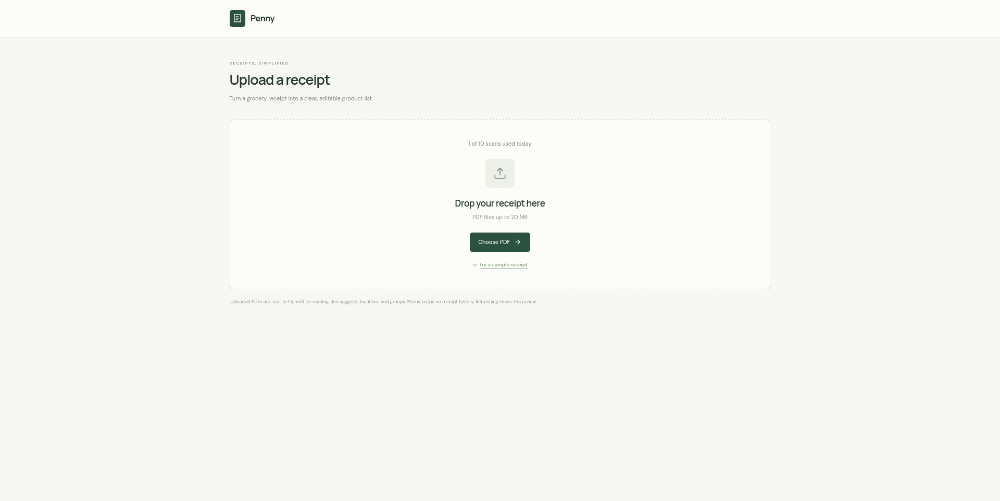
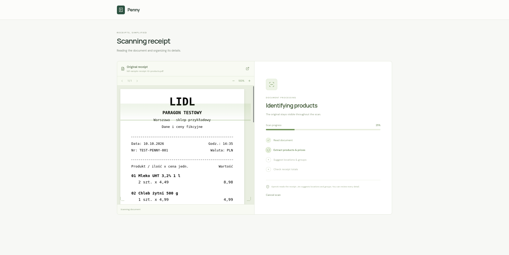
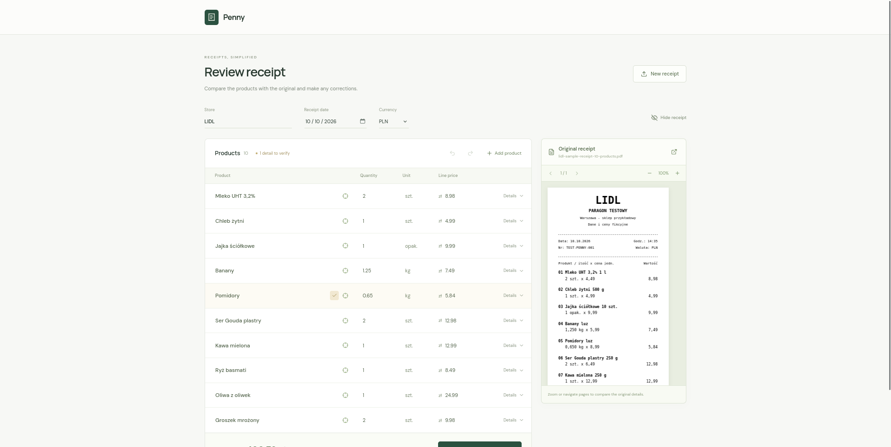

# Penny

Penny turns grocery receipt PDFs into a reviewable product list, then imports confirmed purchases into [Grocy](https://grocy.info/). It uses a Svelte 5 + TypeScript frontend and a Node.js backend. OpenAI extracts receipt lines; Jev suggests storage locations and product groups. A person reviews every field before anything is written to Grocy.

## What it does

1. Upload a PDF receipt (up to 20 MB and 30 pages), or open the built-in sample without using an API key.
2. Penny sends the PDF to OpenAI for product extraction. It shows the original alongside editable names, quantities, units, line prices, store, date, and currency. Searchable PDFs can highlight the source line for a product.
3. Jev suggests a storage location and product group. Low-confidence suggestions stay unassigned. Correct fields, set expiration dates, and compare the total with the receipt.
4. Confirm to import the reviewed products and stock purchases into Grocy. Samples cannot be imported.

The UI supports undo and redo during review. Confirming a stock purchase is a real Grocy write and cannot be undone through Penny.

## Screenshots

### Upload a receipt



### Scan the receipt



### Review products beside the original



## Quick start

Requires Node.js **22.18 or newer**, npm, and API keys for OpenAI and Jev. Grocy and its API key are required for confirmation, but not for trying the sample.

```sh
npm ci
cp .env.example .env
# Edit .env with server-side keys and the Grocy URL for your environment.
npm run dev
```

Open **http://127.0.0.1:5173**. `npm run dev` runs the backend at `127.0.0.1:8787` and Vite at port 5173; Vite proxies `/api` to the backend. Restart the process after editing `.env`. For a single-process local build, run `npm run build` and then `npm start`; open **http://127.0.0.1:8787**.

Run `npm run check`, `npm test`, and `npm run build` to verify a change. Tests mock the external APIs; they do not spend provider credits or buy stock.

For a home-network Docker deployment, see [the deployment guide](deploy/README.md). **Penny has no login or user accounts.** Keep it on a trusted network or put authentication in front of it before exposing it beyond that network.

The server permits **10 accepted scan attempts per day** by default, shared across all clients, resetting at midnight in **Europe/Warsaw**. Failed/cancelled scans count after processing starts; malformed uploads, missing API keys, and sample previews do not. Retries consume another attempt. The only persistent Penny data is the counter’s date and number of attempts, saved atomically in a dedicated volume so container restarts do not reset the limit. Reviews and receipts remain temporary. Run one Penny instance.

## Temporary review only

Penny has no saved-receipt page, autosaved drafts, PDF storage, browser receipt database, or disk import journal. The PDF, extracted products, corrections, and undo/redo history exist only in the open page’s memory. Refresh, closing the page, or starting a new review discards them. A refresh does not automatically repeat a paid extraction request. Uploaded PDFs are limited to 20 MB and 30 pages.

On startup, Penny removes the old `alfred-receipts` and `alfred-draft` localStorage entries and deletes the former `alfred-receipts` IndexedDB database. It does not read or migrate their contents. If another old tab blocks deletion, a message asks you to close old tabs and clear this site’s data. Data saved on other origins or devices must be removed there separately.

The backend processes uploads in memory and writes no receipts, PDFs, extraction responses or import journals to disk. API keys remain in server configuration. OpenAI receives the PDF; Jev receives product details; confirming sends reviewed products to Grocy. These services’ own retention policies and Grocy’s stock history are separate from Penny’s storage. Grocy’s confirmed inventory remains in Grocy.

## Reviewing products

The original PDF stays visible during the scanning animation and beside the editable table, with page navigation and zoom. Product names, quantities, units, line prices, store, receipt date and currency can be corrected. Product Details exposes expiration date, storage location and product group. Locations and groups use the supplied household lists; unassigned suggestions stay blank. Extracted product names omit package weights, volumes, pack counts and sale markers such as “luz”, while keeping brands and meaningful variants such as fat percentage or frozen food. The original receipt text remains available for source matching and classification; removing package text from the name does not change purchase quantities, units or prices. New rows have no default unit. Currency defaults to PLN; changing the currency label does not convert prices.

Undo/redo groups typing within each field and supports row additions, deletions and metadata edits during this review. Use the toolbar or Ctrl/Command+Z, Shift+Ctrl/Command+Z, or Ctrl+Y. Importing stock cannot be undone with this toolbar.

Source coordinates are optional `{ page, x, y, width, height, text? }` on each product. Pages are one-based; rectangles are normalized 0–1 from the upright page’s top-left as PDF.js renders it. Focusing a product or clicking its crosshair jumps to and highlights its real PDF line. The backend associates AI-extracted raw names with searchable PDF line IDs and geometry. Image-only PDFs can be extracted without source highlights. Invalid geometry and unsafe rotated text are skipped.

## Backend configuration

Keep keys in `.env` or server environment variables. Never use browser code or `VITE_` variables for secrets.

```dotenv
OPENAI_API_KEY=your_openai_api_key
JEV_API_KEY=your_jev_api_key
OPENAI_MODEL=gpt-4.1
JEV_MODEL=jev-latest
JEV_CONFIDENCE_THRESHOLD=0.75
GROCY_URL=https://grocy.example.com
GROCY_API_KEY=your_grocy_api_key
PORT=8787
```

`TYPESAFE_API_KEY` is accepted as an alias for `JEV_API_KEY`. Model names are configurable. OpenAI receives an inline PDF and searchable source lines, returns strict schema output, and is called with `store: false`. Unknown quantities, units, prices, merchant and date remain blank for review; expiration dates are never guessed. Prices are line totals after attributable discounts. Unallocated adjustments or mismatched receipt totals are surfaced as warnings.

Jev chooses among the supplied location and group lists. A suggestion needs confidence at least the configured threshold and selected-option probability at least 0.70. Otherwise it stays unassigned and is flagged. Jev failures preserve the extracted products with a warning. The sample receipt is a local preview and makes no provider calls or Grocy writes.

- `GET /api/usage` returns today’s limit, used/remaining attempts, timezone, and next reset time.
- `GET /api/health` returns `ready` for configured AI keys and `grocyReady` for configured Grocy variables; this does not verify connectivity.
- `POST /api/receipts/extract` accepts raw PDF bytes with `Content-Type: application/pdf`. Responses stream newline-delimited `progress`, `result` or `error` events. Validation errors use JSON and HTTP status codes.
- `POST /api/receipts/confirm` accepts `{ id, fingerprint?, store, receiptDate, currency, products }`. Success returns `{ count, total, productIds, confirmedAt }`; errors return `{ error, count, total, uncertain }`.

Local development binds to loopback. Docker binds inside the container to `0.0.0.0` and publishes on host loopback by default; set `PENNY_BIND_IP` to a trusted host interface only when needed. Set comma-separated `APP_ORIGINS` to the exact browser origins you use. `HOST` is configurable for the Node server. `DAILY_RECEIPT_LIMIT` defaults to 10, `RECEIPT_TIMEZONE` to Europe/Warsaw, and `DAILY_USAGE_FILE` to `usage/daily-usage.json` outside Docker. The quota blocks scans if its counter cannot be read or saved. Network users can spend your AI budget and import stock; protect the service accordingly.

## Grocy confirmation

**Confirm & send to Grocy** imports a real reviewed receipt. Every product needs name, quantity, unit, line price, location, group and expiration date. **Does not expire** explicitly selects Grocy’s `2999-12-31` sentinel. Samples have no save or import action.

Grocy keys are sent only by the backend in the `GROCY-API-KEY` header. The URL supports a root, subpath or `/api` suffix. The key needs read access to system configuration, catalogs and stock logs, and write access for products, units, stores, product groups and stock purchases.

The whole receipt is validated before writes. Locations and groups must already exist in Grocy under the selected names. Products match by case-insensitive exact name with whitespace normalization; missing products, units and stores are created. Selected groups update product groups, and locations apply to purchased stock. Currency must match Grocy’s configured currency. kg/g and L/ml convert safely; pieces are never assumed to equal liters and pack contents are not guessed. Ambiguous names, incompatible units, inactive products and special stock/tare handling stop confirmation for review.

Grocy receives line price divided by the stock-unit quantity. The stock-add API has no documented purchase-date parameter, so the receipt date is included in the stock note; Grocy records the confirmation date as purchase date.

Retries use temporary backend progress (bounded to 256 receipts and pruned after 15 minutes on the next request) and stable markers in Grocy’s existing purchase log. No progress is written to Penny’s disk. Completed purchases can be recognized after a backend restart or re-upload even when the new review has new row IDs, provided the PDF bytes and reviewed details match. Changed reviews of an already-imported PDF are blocked. Partial or uncertain confirmation locks the current review; keep the page open and use **Retry confirmation**. If an uncertain write cannot be found in Grocy’s log, confirmation stops for manual inspection. After losing the page or server’s temporary state, check Grocy before submitting again: without durable state, late or unlogged writes cannot be guaranteed duplicate-free. Run a single backend process; distributed import locking is not implemented.

## Verification

Automated tests cover concurrent daily quotas, restart recovery, Warsaw midnight/DST reset, unavailable counters, LAN host/origin restrictions, plain HTTP browser crypto compatibility, in-memory undo, fingerprints, source geometry, provider contracts, streamed responses, classification uncertainty, upload/origin validation, Grocy unit pricing and conversions, catalog creation, preflight checks, partial failures and stock-log retry recovery. APIs are mocked; no paid calls or live Grocy purchases are made. The synthetic PDF fixture is `tests/fixtures/source.pdf`.

References: [Grocy API specification](https://raw.githubusercontent.com/grocy/grocy/refs/heads/master/grocy.openapi.json), [OpenAI PDF inputs](https://developers.openai.com/api/docs/guides/file-inputs), [OpenAI structured outputs](https://developers.openai.com/api/docs/guides/structured-outputs?api-mode=responses), [TypeSafe API](https://docs.typesafe.ai/api).
